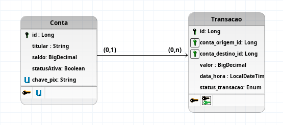

## Modelo Lógico

## Regras de Negócio 

- **RN01 - Autenticidade da Conta:** Tanto a conta de origem como a conta de destino precisam de estar ativas no sistema.
- **RN02 - Saldo Suficiente:** O saldo disponível na conta de origem deve ser maior ou igual ao valor da transferência solicitada.
- **RN03 - Validação de Destino:** Não é permitido realizar transferências em que a conta de origem seja igual à conta de destino.
- **RN04 - Limite por Transação:** O valor máximo permitido por transação PIX é de **R$ 5.000,00**.
- **RN05 - Atomicidade:** A débito de uma conta e o crédito na outra devem ser executados na mesma transação `@Transactional`. Se falhar uma etapa, deve ser feito o *rollback* total.